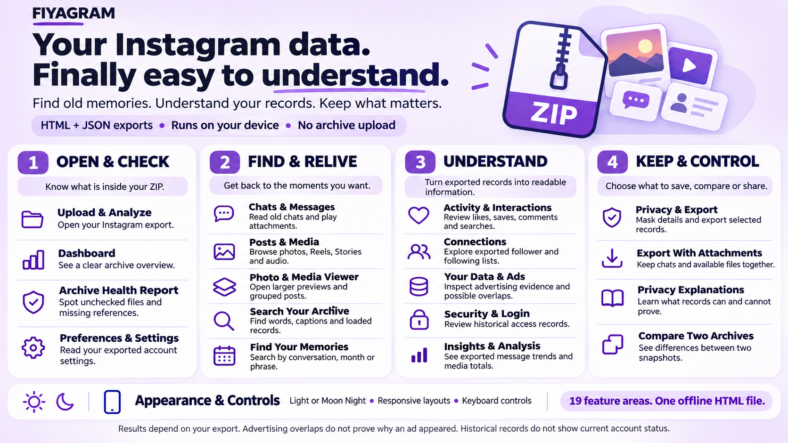

# FIYAGRAM

**Explore your Instagram archive privately, on your own device.**

FIYAGRAM is a single-file website for exploring Instagram **HTML and JSON export ZIPs**. No installation, account or backend is required. This independent project is not affiliated with Meta or Instagram.

*AI-generated feature illustration, not a screenshot of a person's archive.*

## Get started

1. Download [index.html](index.html) using GitHub's **Download raw file** button.
2. Open it in a recent desktop Chrome or Edge browser.
3. Choose **Upload & Analyze** and select your complete Instagram export ZIP.
4. Explore your dashboard and the sidebar tools.

Keep your ZIP intact so the website can find media alongside its records. To use GitHub Pages, open repository Settings > Pages, select Deploy from a branch, and select your publishing branch and /(root).

## Features

- Dashboard summaries and clearly labelled monthly/yearly message charts.
- Searchable chats, attachments and conversation exports.
- Photo, video, Reel, Story and audio browsing with previews and a media viewer.
- Available activity, connection, preference and historical security records.
- Advertising Footprint and Evidence Explorer with labelled possible activity-to-ad overlaps.
- Archive Health Report, memory-finding tools and exports with available attachments.
- Privacy explanations and supported comparisons between two archive snapshots.
- Back navigation, light/dark themes and keyboard controls.

## Privacy and limitations

Archive analysis happens locally in your browser. The ZIP reader, scripts and styles are bundled inside `index.html`; no remote library downloads are needed. Archive contents stay in the page's memory and are discarded when the page is reloaded or closed. The theme preference is saved locally, and any files you download remain where you save them.

A hosted copy requires an initial page request, which its hosting provider may log. For offline use, download the HTML first. External links open websites if you click them.

Compatibility is best effort and features depend on what your export contains. Missing files cannot be recovered. Charts describe exported message activity, not exact screen time. Advertising overlaps do not prove targeting, and differences between archives do not prove deletion or unfollowing.

Masking and blur are viewing aids, not a guarantee that a screenshot or export is safe to share. Never publish personal Instagram ZIPs, conversations, attachments or unredacted reports.

## Repository contents

| File | Purpose |
| --- | --- |
| `index.html` | Complete offline website; edit this file directly to change the app. |
| `README.md` | Introduction, usage and limitations. |
| `LICENSE` | Rights policy for original project material. |
| `THIRD_PARTY_NOTICES.md` | Notices for external software bundled into the website. |
| `.gitignore` | Excludes common private archives and temporary files. |
| `features-overview.png` | Public feature illustration. |

This simplified repository has no build step or included automated test suite. The earlier development version was checked with synthetic HTML and JSON archives; that does not guarantee compatibility with every Instagram export. After editing the HTML, check import, navigation, chats, media and exports in your browser using non-sensitive test data.

## Rights

Reuse permission for original FIYAGRAM code and artwork is not granted at this time; see [LICENSE](LICENSE). Bundled third-party software retains its own permissions; see [THIRD_PARTY_NOTICES.md](THIRD_PARTY_NOTICES.md). Its notices are also embedded in the HTML.
